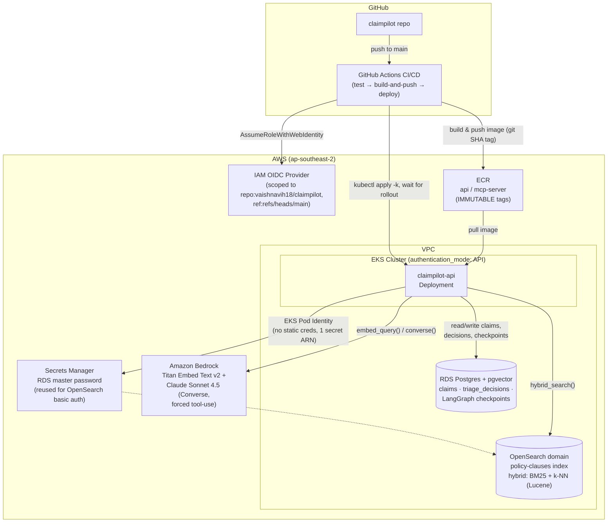
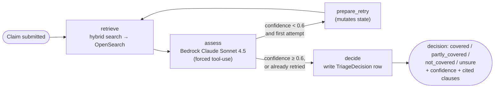

# ClaimPilot

**An agentic insurance-claims triage assistant, built on AWS with LangGraph and Amazon Bedrock.**

Given a home-insurance claim and a corpus of policy documents, an agent retrieves the relevant clauses, reasons over them with an LLM, and returns a structured triage decision (`covered` / `partly_covered` / `not_covered` / `unsure`) with cited clauses and a confidence score — retrying its own retrieval once if it isn't confident enough the first time. All data is synthetic (AU home-insurance policies and claims); nothing here touches real customer data.

## Architecture



### Agent decision flow (LangGraph)



A linear graph with a single conditional edge: low-confidence retrieval gets exactly one retry, not an unbounded loop. If confidence is still low after the retry, the decision is forced to `unsure` rather than returned with false certainty. Every run is checkpointed in Postgres via LangGraph's `PostgresSaver`, keyed by `claim_id`.

## Tech stack

| Layer | Choice | Why |
|---|---|---|
| Orchestration | LangGraph `StateGraph` | Explicit, inspectable state machine rather than an implicit agent loop — the retry logic is a visible edge, not hidden control flow |
| LLM | Bedrock Claude Sonnet 4.5, forced tool-use | Guaranteed structured output (decision/confidence/citations) without parsing JSON out of prose |
| Embeddings | Bedrock Titan Embed Text v2 (1024-dim) | Native Bedrock embedding, no separate embedding provider/account |
| Retrieval | OpenSearch hybrid search (BM25 + k-NN, Lucene engine) | Lucene (not NMSLIB) is required for filtered k-NN queries |
| Relational store | RDS Postgres + pgvector, SQLAlchemy/Alembic | Claims, triage decisions, and LangGraph checkpoints in one durable store |
| Compute | EKS | Container orchestration for the API; Pod Identity for credential-free AWS access |
| IaC | Terraform | VPC, RDS, OpenSearch, EKS, ECR, IAM, Secrets Manager, GitHub OIDC |
| CI/CD | GitHub Actions + OIDC | No long-lived AWS keys in GitHub; role trust scoped to this repo's `main` branch only |

## Repo structure

```
claimpilot/
├── app/
│   ├── app/
│   │   ├── agent/        # LangGraph nodes, state, prompts, graph wiring
│   │   ├── core/         # config, secrets, path resolution
│   │   └── db/           # SQLAlchemy models, session, seeding
│   ├── ingest/            # OpenSearch index creation + policy ingestion
│   ├── migrations/        # Alembic
│   ├── scripts/           # test_agent_graph.py (local + CI test harness)
│   └── requirements.txt
├── infra/terraform/        # VPC, RDS, OpenSearch, EKS, ECR, IAM, OIDC, Pod Identity
├── k8s/                     # Kustomize manifests for the API deployment
├── data/synthetic/          # Generated AU policies + claims (no real data)
├── docker/                  # Local docker-compose Postgres, etc.
└── .github/workflows/       # ci-cd.yml
```

## Running it locally

```bash
docker compose -f docker/docker-compose.yaml up -d
```

```bash
cd app && alembic upgrade head
```

```bash
python -m app.db.seed_claims
```

```bash
python ingest/ingest.py --recreate-index
```

```bash
python -m app.agent.run CLM-001
```

Against the real AWS infra instead of local Postgres/OpenSearch, point the agent at the real OpenSearch domain and RDS instance (see `app/app/agent/clients.py` — it branches on the `OPENSEARCH_HOST` env var, using Secrets-Manager-backed basic auth when it's not `localhost`).

## CI/CD

Three jobs, `test → build-and-push → deploy`:

- **test** runs on every push and every PR (including from a fork) with zero AWS credentials — a real Postgres service container lets it run actual Alembic migrations and the agent-graph test (`scripts/test_agent_graph.py`, using fake Bedrock/OpenSearch clients by design).
- **build-and-push** and **deploy** only run on a push to `main`, authenticate to AWS via OIDC (no stored keys), tag images by short git SHA (ECR repos are immutable), and `deploy` waits on `kubectl rollout status` so a broken image fails the pipeline instead of silently going live.

## Key design decisions

- **Retry once, not in a loop** — a second low-confidence result returns `unsure` rather than retrying indefinitely or returning false certainty.
- **Forced tool-use for the LLM call** — the decision schema is enforced by Bedrock's Converse API tool-choice, not parsed out of free text.
- **Hybrid search on Lucene, not NMSLIB** — NMSLIB doesn't support filtered k-NN at all; Lucene does, natively, since OpenSearch 2.9.
- **One Secrets Manager secret, reused** — the OpenSearch domain's basic-auth credentials are the same RDS master password, scoped to the API's Pod Identity role for exactly that one ARN, rather than a second secret.
- **GitHub Actions OIDC, scoped tightly** — the CI role's trust policy only allows `repo:vaishnavih18/claimpilot:ref:refs/heads/main`; PR runs never get AWS credentials at all.

## Known findings

On the first real end-to-end run against live AWS infrastructure (`CLM-001`), the agent returned `unsure` (confidence 0.20) against an expected label of `covered` — a genuine retrieval gap (one expected clause, `HOME-3.1`, never surfaced in the top results) rather than a bug. This is exactly the kind of finding the planned eval harness is meant to characterize systematically across the full labelled claim set, rather than one claim at a time.

## Roadmap

- [x] Terraform infra (VPC, RDS, OpenSearch, EKS, ECR, IAM, Secrets Manager)
- [x] LangGraph agent (retrieve → assess → conditional retry → decide)
- [x] Real ingestion + seeding against live AWS
- [x] GitHub Actions CI/CD with OIDC
- [ ] Eval harness across the full labelled claim set
- [ ] MCP server
- [ ] GraphQL API layer
- [ ] React frontend
