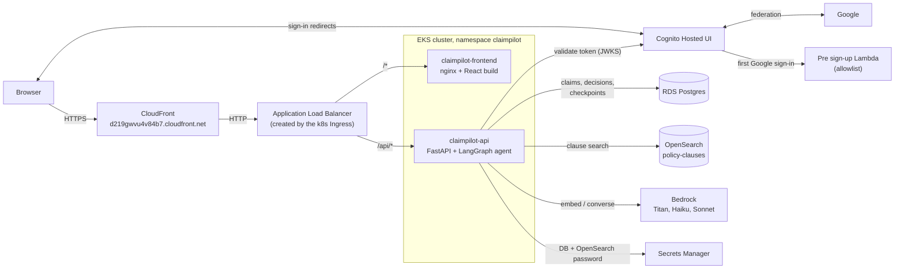
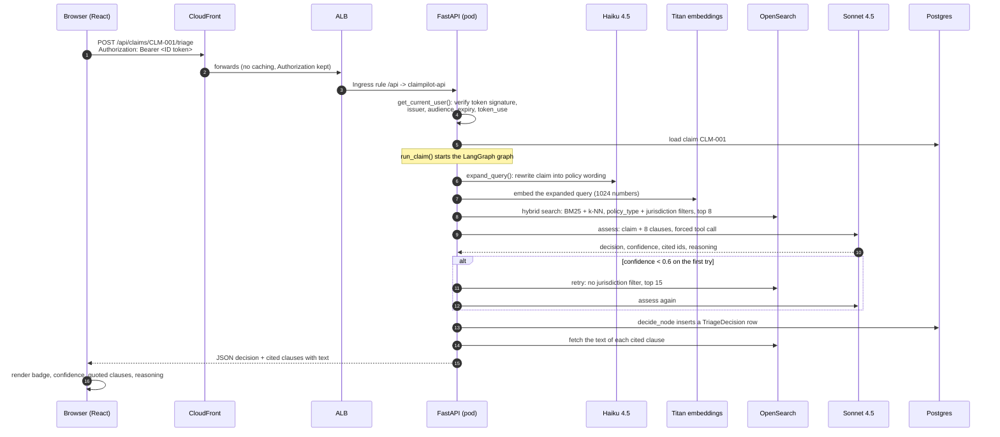
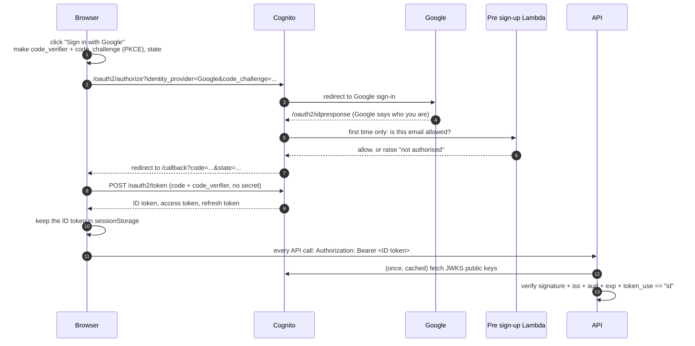
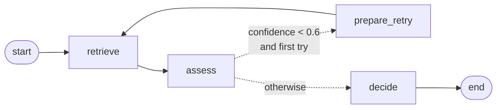
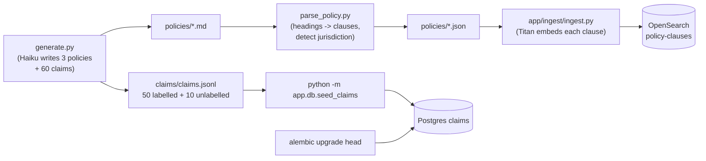
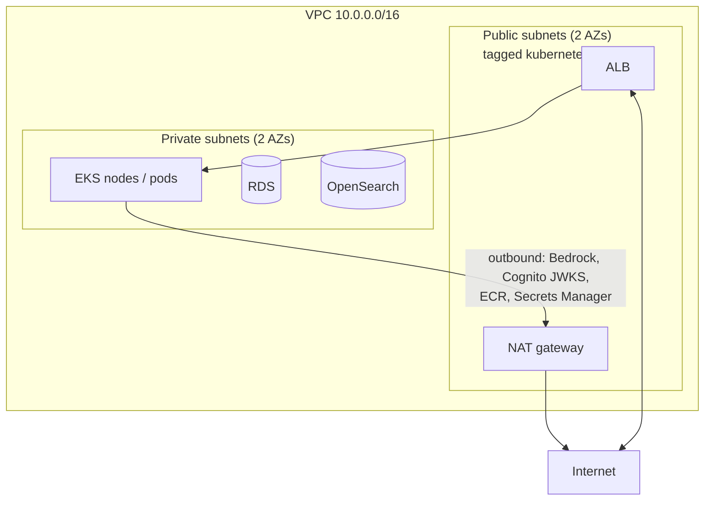
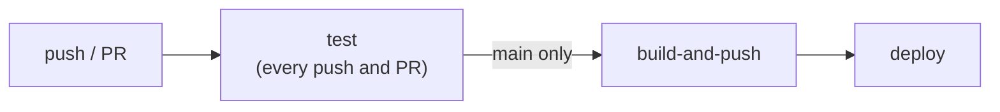

# ClaimPilot: how it all fits together

This guide is for understanding the whole system, end to end: what each piece does, why it is there, and what happens, hop by hop, when someone signs in and runs a triage. It also records the problems hit while building it, because those explain a lot about how the pieces connect.

If you only read one section, read [The life of one triage request](#3-the-life-of-one-triage-request).

**Contents**

1. [What ClaimPilot does](#1-what-claimpilot-does)
2. [The big picture](#2-the-big-picture)
3. [The life of one triage request](#3-the-life-of-one-triage-request)
4. [Signing in: Cognito, Google and the API check](#4-signing-in-cognito-google-and-the-api-check)
5. [The agent: LangGraph in detail](#5-the-agent-langgraph-in-detail)
6. [The data: what lives where and how it got there](#6-the-data-what-lives-where-and-how-it-got-there)
7. [The AWS infrastructure](#7-the-aws-infrastructure)
8. [Permissions: who is allowed to do what](#8-permissions-who-is-allowed-to-do-what)
9. [Shipping code: CI/CD](#9-shipping-code-cicd)
10. [Configuration: every setting and where it comes from](#10-configuration-every-setting-and-where-it-comes-from)
11. [Measuring quality: the eval harness](#11-measuring-quality-the-eval-harness)
12. [Local vs deployed](#12-local-vs-deployed)
13. [What is manual (one-time setup)](#13-what-is-manual-one-time-setup)
14. [Debugging playbook: problems we actually hit](#14-debugging-playbook-problems-we-actually-hit)
15. [Observing it running](#15-observing-it-running)
16. [Cost and teardown](#16-cost-and-teardown)
17. [Glossary](#17-glossary)
18. [Exercises to learn it hands-on](#18-exercises-to-learn-it-hands-on)

---

## 1. What ClaimPilot does

A user picks an insurance claim (home, motor or travel, all synthetic) and presses **Run triage**. An agent:

1. finds the policy clauses most likely to matter (hybrid keyword + vector search),
2. asks Claude whether the claim is covered, based only on those clauses,
3. retries the search once, wider, if Claude isn't confident,
4. stores the decision and shows it with the quoted clauses it relied on.

The output is one of `covered`, `partly_covered`, `not_covered` or `unsure`, plus a confidence score, the cited clause IDs and a short reasoning paragraph. Every decision is stored, never overwritten, so the table doubles as an audit log.

## 2. The big picture



Three ideas carry the whole design:

- **One front door.** CloudFront gives the app a free HTTPS address. Behind it, one load balancer routes `/api/*` to the API and everything else to the frontend. Same origin for both means no CORS problems in production.
- **The API protects itself.** The login screen is a convenience. The real gate is the API, which rejects any request without a valid Cognito ID token.
- **Two stores, each for what it's good at.** Postgres holds transactional data (claims, decisions, agent checkpoints). OpenSearch holds the policy clauses and does the searching. Nothing is duplicated between them.

## 3. The life of one triage request

You are signed in at `https://d219gwvu4v84b7.cloudfront.net`, open claim `CLM-001`, and press **Run triage**. Here is every hop.



Step by step, with the file that does it:

| # | What happens | Where |
|---|---|---|
| 1 | The browser sends the request with the ID token from sessionStorage. | `frontend/src/api.ts` (`request()`) |
| 2 | CloudFront forwards it. The default behavior has caching off, and the origin request policy forwards all headers except Host, so the token survives. Origin read timeout is 60s. | `infra/terraform/cloudfront.tf` |
| 3 | The ALB matches the Ingress rule `/api` and sends it to the API Service. | `k8s/ingress.yaml` |
| 4 | FastAPI's router-level dependency checks the token before any route code runs. A bad token stops here with 401. | `app/app/auth.py`, `app/app/routes.py` |
| 5 | The route loads the claim from Postgres and builds the dict `run_claim` expects. | `app/app/routes.py` (`triage_claim`) |
| 6 | The graph runs: retrieve, assess, maybe retry, decide (section 5). | `app/app/agent/graph.py`, `nodes.py` |
| 7 | `decide_node` inserts the decision. The route reads it back by ID. | `app/app/agent/nodes.py` |
| 8 | For each cited clause ID, the API looks up the clause text in OpenSearch so the UI can quote it. If OpenSearch is down, text is `null` and the decision still returns. | `app/app/agent/retrieval.py` (`fetch_clause_texts`) |
| 9 | The page renders the decision and blockquotes. | `frontend/src/ClaimDetail.tsx` |

A triage makes 3 to 6 model calls (one Haiku rewrite, one or two Titan embeddings, one or two Sonnet assessments), which is why it takes 10 to 20 seconds and why the timeouts along the path matter (section 14).

## 4. Signing in: Cognito, Google and the API check

### The pieces

- **Cognito user pool** (`infra/terraform/cognito.tf`): the identity system. It issues the tokens the API trusts.
- **Hosted UI** at `https://claimpilot-auth-202113032991.auth.ap-southeast-2.amazoncognito.com`: Cognito's own login pages. The domain root shows nothing; only paths like `/oauth2/authorize`, `/login` and `/logout` do.
- **App client** `3r6tsvcm4pnof3ni1lp6nih79v`: the frontend's registration. Public (no secret), Authorization Code flow, scopes `openid email profile`, and an exact list of allowed callback URLs.
- **Google identity provider**: Cognito hands authentication to Google, so no passwords are stored in Cognito for Google users.
- **Pre sign-up Lambda** (`infra/terraform/lambda/presignup.py`): runs the first time a Google user signs in and blocks anyone not on the allowlist.

### The flow



### Why each part exists

- **PKCE.** A browser app can't keep a client secret, so instead it makes a random `code_verifier`, sends only its hash at the start, and must present the original when exchanging the code. Someone who steals the code from the URL can't use it. Code: `frontend/src/auth.ts`.
- **`state`.** A random value checked on return, so a forged callback is rejected.
- **ID token, not access token.** The ID token carries who the user is (`email`, `sub`) and its `aud` is the app client ID, which is exactly what the API checks.
- **sessionStorage.** The token disappears when the tab closes and isn't shared with other tabs, unlike localStorage.
- **The API's check** (`app/app/auth.py`): signature against Cognito's published keys (JWKS, cached for an hour, re-fetched on an unknown key ID), `iss` must be this pool, `aud` must be this client, not expired, `token_use` must be `id`, algorithm must be RS256. Anything wrong is 401. Missing configuration is 503, so it never fails open. `app/scripts/test_auth.py` proves each of these and runs in CI.
- **Why the callback must be HTTPS.** Cognito only accepts `http://` callbacks for `localhost`, and browsers only expose the crypto PKCE needs on HTTPS or localhost. The ALB is HTTP-only, so CloudFront's HTTPS address is what makes the deployed login possible.
- **The allowlist.** With Google, anyone with a Google account could otherwise sign in and spend Bedrock money. The Lambda allows only `allowed_emails` / `allowed_email_domains`, requires a verified email, and denies everyone if the list is empty. It logs the reason for each denial to CloudWatch.

## 5. The agent: LangGraph in detail

### What LangGraph is (and isn't)

LangGraph is an open-source Python library for writing an agent as a **state machine**: named steps (nodes), the arrows between them (edges), and a shared state dictionary each step reads and updates. It is code, not a low-code tool, and AWS has no console page for it: from AWS's point of view the agent is just the API container making calls to Bedrock, OpenSearch and Postgres.

Why use it rather than a plain function? The retry is a visible edge you can test, every step's state is saved automatically (checkpointing), and the flow is inspectable rather than hidden in a loop.

### The graph



This is generated from the real code (`build_graph().compile().get_graph().draw_mermaid()`).

### The state (`app/app/agent/state.py`)

| Field | Set by | Meaning |
|---|---|---|
| `claim_id`, `claim_text`, `policy_type`, `claimant_state`, `amount_claimed`, `prior_claims_count` | the caller | the claim |
| `retrieval_query` | first `retrieve` | the claim rewritten into policy wording (reused on retry) |
| `retrieved_clauses` | `retrieve` | clauses found this try (overwritten on retry) |
| `decision`, `confidence`, `cited_clause_ids`, `reasoning` | `assess` | the model's answer |
| `retry_count` | `prepare_retry` | 0 or 1 |
| `triage_decision_id` | `decide` | the database row's ID |

### The nodes (`app/app/agent/nodes.py`)

**retrieve**
1. `expand_query()`: Haiku 4.5 rewrites the claim into the wording a policy would use (the event, the type of cover, likely exclusions). The original claim text is kept and the rewrite appended. If Haiku fails, it falls back to the plain claim text. `QUERY_EXPANSION=0` turns it off.
2. `hybrid_search()` (`retrieval.py`):
   - **BM25** keyword match on `heading` (weighted x2) and `text`.
   - **k-NN** vector match: the query is embedded with Titan v2 and compared by cosine similarity to each clause's stored embedding.
   - OpenSearch's search pipeline normalises both scores (min-max) and averages them 50/50.
   - Filters: `policy_type` always; `jurisdiction` (the claimant's state or `national`) on the first try only.
   - `k` = 8 on the first try, 15 on the retry.

**assess**
- Sends the claim and the clauses to Sonnet 4.5 through Bedrock's Converse API with a **forced tool call** (`submit_triage_decision`, schema in `prompts.py`). Bedrock guarantees the reply is that tool call, so there's no free text to parse.
- The system prompt says: decide only from the given clauses; a general scope-of-cover clause is enough for `covered` if no exclusion applies; `unsure` only when the clauses genuinely can't settle it; `partly_covered` only when a clause implies a partial payout.
- The output is then sanity-checked in code: cited IDs must be among the retrieved clauses, and confidence is clamped to 0-1.

**route_after_assess / prepare_retry**
- If confidence < `RETRY_CONFIDENCE_THRESHOLD` (0.6) and this is the first try, go to `prepare_retry`, which only increments `retry_count`. (A conditional edge can't change state, so the increment needs its own node.)

**decide**
- If a retry happened and confidence is still below 0.6, the decision is forced to `unsure`: two weak guesses don't make one confident answer.
- Inserts a `TriageDecision` row (append-only) with the model ID used.

### Checkpointing

The graph is compiled with LangGraph's `PostgresSaver`, so after every step the full state is saved to Postgres tables created by migration `0002_langgraph_checkpoints.py`. The thread ID is the claim ID. Two consequences:

- You can inspect exactly what each step saw for any claim (section 15).
- A re-run of the same claim reuses the same thread. It still produces a fresh decision row, but it is not a perfectly clean slate in the checkpoint history.

## 6. The data: what lives where and how it got there

### Where things live

| Store | Contents | Why there |
|---|---|---|
| Postgres `claims` | one row per claim; includes eval-only `expected_decision` / `expected_clauses` / `notes` | relational, transactional |
| Postgres `triage_decisions` | one row per agent run, never updated (the audit log) | append-only history |
| Postgres checkpoint tables | LangGraph state after every step | resumable, inspectable runs |
| OpenSearch `policy-clauses` | 135 clauses (45 per policy type): `clause_id`, `policy_type`, `jurisdiction`, `scope`, `heading`, `text`, 1024-dim `embedding` | built for search |
| `data/synthetic/` in git | the generated policies (`.md` and parsed `.json`) and `claims.jsonl` | the source of truth for both stores |

Clause text is deliberately only in OpenSearch. When the UI needs a clause's text, the API looks it up there by ID.

### How the data was made and loaded



- `generate.py` used Claude Haiku on Bedrock to write three fictional Australian policy wordings section by section, then generated claims that cite real clause IDs. (Its docstring says 45 labelled + 15 unlabelled; the actual file has 50 + 10.)
- `parse_policy.py` splits the Markdown into clauses by heading and detects state-specific clauses from state names.
- `ingest.py` embeds `heading + text` for each clause and indexes it. It creates the index mapping first, using the **Lucene** k-NN engine, because the older NMSLIB engine rejects filtered vector queries.
- Alembic creates the schema; `seed_claims` loads `claims.jsonl` (safe to re-run: existing claims are left alone).

## 7. The AWS infrastructure

Everything is Terraform in `infra/terraform/`, region `ap-southeast-2` (Sydney), with local state (`terraform.tfstate`, gitignored).

### Network (`vpc.tf`)



- The ALB is the only thing reachable from the internet (via CloudFront, or directly over HTTP).
- RDS and OpenSearch are private: no public endpoint. Your laptop reaches them only through a `kubectl port-forward` to a small `socat` proxy pod (section 13).
- Pods reach AWS APIs and Google/Cognito through the NAT gateway.

### Services

| Service | Resource | Notes |
|---|---|---|
| EKS (`eks.tf`) | `claimpilot-cluster`, Kubernetes 1.31, **Auto Mode** | AWS manages nodes, scaling, patching and load balancers. A `LoadBalancer` Service would get an NLB; an Ingress gets an ALB. |
| RDS (`rds.tf`) | Postgres 16 + pgvector, `db.t4g.micro` | private, encrypted, single-AZ (demo) |
| OpenSearch (`opensearch.tf`) | `claimpilot-search`, 2.15, `t3.small.search` | VPC-only, fine-grained access control with an internal master user, access policy allowing basic-auth requests |
| Secrets Manager (`secrets.tf`) | `claimpilot-rds-credentials` | generated password; reused as the OpenSearch master password |
| ECR (`ecr.tf`) | `claimpilot/api`, `claimpilot/frontend`, `claimpilot/mcp-server` | IMMUTABLE tags, scan on push, untagged images expire after 7 days |
| Cognito (`cognito.tf`) | user pool, Hosted UI domain, app client, Google IdP, pre sign-up Lambda | see section 4 |
| CloudFront (`cloudfront.tf`) | `https://d219gwvu4v84b7.cloudfront.net` | free HTTPS; only `/assets/*` cached |
| S3 (`s3.tf`) | `claimpilot-documents-<account>` | reserved for claim documents (not used by the app yet) |
| IAM (`iam.tf`, `pod_identity.tf`, `github_oidc.tf`) | roles for the cluster, nodes, API pod, CI | section 8 |

### Kubernetes objects (`k8s/`)

| File | Object | Purpose |
|---|---|---|
| `namespace.yaml` | Namespace `claimpilot` | |
| `service-account.yaml` | ServiceAccount `claimpilot-api` | the identity Pod Identity maps to an IAM role |
| `config.yaml` | ConfigMap `claimpilot-config` | Cognito IDs, Google flag, API base URL (not secrets) |
| `deployment.yaml` / `service.yaml` | API Deployment + ClusterIP Service | 1 replica, `/health` probes |
| `frontend-deployment.yaml` / `frontend-service.yaml` | frontend Deployment + ClusterIP Service | nginx on 8080, Service port 80 |
| `ingress.yaml` | Ingress `claimpilot` | one ALB: `/api` -> API, `/` -> frontend |
| `cluster/ingressclass.yaml` | IngressClass + IngressClassParams `alb` | tells Auto Mode to build an internet-facing ALB, idle timeout 120s. Applied once by hand (cluster-scoped). |

### The frontend container (`frontend/`)

- **Build stage**: Node builds the React app into static files.
- **Run stage**: unprivileged nginx (non-root, port 8080) serves them.
- **Runtime config**: at start-up, `docker-entrypoint.d/40-config.sh` writes `/config.js` from environment variables (from the ConfigMap). The same image works in any environment; nothing environment-specific is baked in.
- **nginx** (`nginx/default.conf.template`): SPA fallback (unknown paths serve `index.html`), no caching for `index.html` and `config.js`, long caching for `/assets/`, and a fallback `/api/` proxy to the API Service so the frontend also works through a port-forward. The proxy resolves the API's address at request time, so nginx starts even if the API isn't up.

## 8. Permissions: who is allowed to do what

There are no long-lived AWS keys in the cluster or in GitHub. Each actor gets a role scoped to what it needs.

| Actor | How it gets credentials | What it may do |
|---|---|---|
| API pod | **EKS Pod Identity**: ServiceAccount `claimpilot-api` mapped to role `claimpilot-api-pod-role` | read one secret (`claimpilot-rds-credentials`); `bedrock:InvokeModel` on Titan v2, the `au.` Sonnet 4.5 and Haiku 4.5 profiles and their underlying models in ap-southeast-2 and ap-southeast-4 |
| API -> OpenSearch | username + password from that secret (HTTP basic auth) | fine-grained access control as the master user; the domain's access policy lets basic-auth requests through |
| API -> RDS | same secret | full access to the app database |
| GitHub Actions | **OIDC**: GitHub proves "this is a push to main of vaishnavih18/claimpilot"; AWS trusts only that | push to the project's ECR repos; describe the cluster; edit objects in the `claimpilot` namespace only |
| Cognito | service role / Lambda permission | invoke the pre sign-up Lambda |
| Pre sign-up Lambda | its own role | write its logs |
| You (Terraform) | profile `claimpilot-static` (a static key on `vaish-admin`) | everything; deactivate the key when the project is done |
| You (CLI, kubectl) | profile `claimpilot` | admin |

Two details worth remembering:

- **Cross-region inference profiles** (`au.anthropic...`) need permission on the profile *and* on the model in every region the profile can route to.
- **"anonymous" in an OpenSearch error** means the request carried no AWS identity, which is normal for basic auth. It's the access policy, not the password, that rejects such requests.

## 9. Shipping code: CI/CD

`.github/workflows/ci-cd.yml` has three jobs:



- **test**: Postgres service container, `alembic upgrade head`, the agent graph test (fake Bedrock/OpenSearch, real Postgres) and the auth tests. No AWS credentials at all, so it is safe for PRs from forks.
- **build-and-push**: assumes the CI role via OIDC, builds the API and frontend images, tags both with the first 12 characters of the commit SHA, pushes to ECR.
- **deploy**: `kustomize edit set image` swaps the placeholders for the new tags, `kubectl apply -k k8s/`, then waits for both Deployments to roll out. A broken image fails the pipeline instead of going live.

What CI does **not** do: run Terraform, apply `k8s/cluster/`, run migrations, seed claims or ingest clauses. Those are manual (section 13).

## 10. Configuration: every setting and where it comes from

### API

| Variable | Local | Deployed |
|---|---|---|
| `DATABASE_URL` | set by you (docker Postgres) | not set |
| `RDS_SECRET_ARN` | not set | `deployment.yaml`; the API builds the DB URL from the secret |
| `OPENSEARCH_HOST` | unset = local docker OpenSearch, no auth | the VPC domain endpoint, HTTPS + basic auth |
| `AWS_PROFILE` | `claimpilot` | not set (Pod Identity) |
| `AWS_REGION` | `ap-southeast-2` | `ap-southeast-2` |
| `COGNITO_USER_POOL_ID`, `COGNITO_APP_CLIENT_ID` | exported by you | from the ConfigMap |
| `QUERY_EXPANSION` | default on; `0` = off | default on |

Model IDs are constants in `app/app/agent/clients.py`: `amazon.titan-embed-text-v2:0`, `au.anthropic.claude-sonnet-4-5-20250929-v1:0`, `au.anthropic.claude-haiku-4-5-20251001-v1:0`. If you change one, also update the pod's Bedrock policy in `pod_identity.tf`.

### Frontend

| Setting | Local (`frontend/.env`) | Deployed (`k8s/config.yaml` -> `/config.js`) |
|---|---|---|
| API base URL | `VITE_API_BASE_URL=http://localhost:8000` | `API_BASE_URL: ""` (same origin) |
| Hosted UI domain | `VITE_COGNITO_DOMAIN` | `COGNITO_DOMAIN` |
| App client ID | `VITE_COGNITO_CLIENT_ID` | `COGNITO_APP_CLIENT_ID` |
| Google button | `VITE_GOOGLE_LOGIN` | `GOOGLE_LOGIN` |

### Terraform variables you set yourself

| Variable | Purpose | How to pass |
|---|---|---|
| `google_client_id`, `google_client_secret` | Google sign-in | `export TF_VAR_...` (never in a committed file) |
| `alb_dns_name` | CloudFront origin | `export TF_VAR_alb_dns_name=$(kubectl -n claimpilot get ingress claimpilot -o jsonpath='{.status.loadBalancer.ingress[0].hostname}')` |
| `allowed_emails`, `allowed_email_domains` | sign-in allowlist | default allows `vaishnavih18@gmail.com` |
| `frontend_production_url` | a future custom domain | empty for now |

**Always check `terraform plan` before applying.** If the Google or ALB variables aren't set in that terminal, Terraform thinks they were removed and plans to **destroy** the Google provider or the CloudFront distribution.

## 11. Measuring quality: the eval harness

`evals/run_eval.py` runs the real graph on all 50 labelled claims, without writing to `triage_decisions`, and writes `evals/eval-report.md`. For each expected clause the agent didn't cite, it says why:

- `corpus_gap`: the clause doesn't exist,
- `retrieval_miss`: it exists but neither search returned it,
- `jurisdiction_filtered`: the first-try state filter excluded it (checked with an extra unfiltered search),
- `citation_miss`: it was retrieved but the model didn't cite it.

| | Baseline | + query expansion | + prompt change |
|---|---|---|---|
| Decision accuracy | 64% | 68% | **78%** |
| `retrieval_miss` | 13 | 4 | 8 |

The lesson from those runs: first find *where* the pipeline loses the answer (the categories), then fix that layer. Query expansion fixed retrieval; the prompt change fixed the model treating "the peril isn't named" as "unsure". Open issues and caveats are in the README's Eval results section.

## 12. Local vs deployed

| | Local | Deployed |
|---|---|---|
| Frontend | `npm run dev` at `http://localhost:5173` | nginx pod, via CloudFront |
| API | `uvicorn` on your laptop | pod in EKS |
| Postgres | docker-compose (`claimpilot_local_dev`) | RDS via Secrets Manager |
| OpenSearch | docker-compose, no security, port 9200 | VPC domain, HTTPS + basic auth |
| Bedrock credentials | your `claimpilot` profile | Pod Identity role |
| Sign-in callback | `http://localhost:5173/callback` | `https://d219gwvu4v84b7.cloudfront.net/callback` |
| Data | seeded and ingested locally | seeded and ingested into RDS / the domain separately |

Local and deployed have **separate data**. Ingesting locally does not populate the deployed OpenSearch, which is exactly why the deployed app once failed with "no such index".

## 13. What is manual (one-time setup)

In order, for a fresh environment:

1. `terraform apply` in `infra/terraform/` (with the `TF_VAR_` variables from section 10 once Google and CloudFront exist).
2. Fill `k8s/config.yaml` from `terraform output` and commit it.
3. `kubectl apply -f k8s/cluster/ingressclass.yaml` (once).
4. Push to `main` so CI builds and deploys.
5. Migrate and seed RDS through a proxy pod:
   ```
   kubectl run db-proxy --image=alpine/socat --restart=Never -- "tcp-listen:5432,fork,reuseaddr" "tcp-connect:<rds-endpoint>:5432"
   kubectl port-forward pod/db-proxy 5432:5432
   # in another terminal, with DATABASE_URL pointing at localhost:5432 and the real credentials (?sslmode=require):
   cd app && alembic upgrade head && python -m app.db.seed_claims
   ```
6. Ingest the clauses into the deployed OpenSearch through a proxy pod:
   ```
   OS=<opensearch_endpoint from terraform output>
   kubectl run os-proxy --image=alpine/socat --restart=Never -- "tcp-listen:443,fork,reuseaddr" "tcp-connect:$OS:443"
   kubectl port-forward pod/os-proxy 9443:443
   # in another terminal:
   cd app && AWS_PROFILE=claimpilot python ingest/ingest.py --opensearch-host localhost --opensearch-port 9443 \
     --opensearch-tls-hostname $OS --opensearch-secret-arn <rds_credentials_secret_arn>
   kubectl delete pod os-proxy
   ```
   `--opensearch-tls-hostname` is needed because the domain's certificate names the real hostname, not `localhost`.
7. After the Ingress has an ALB, set `TF_VAR_alb_dns_name` and `terraform apply` again to create CloudFront.
8. Optional: turn on Bedrock model invocation logging (section 15).

## 14. Debugging playbook: problems we actually hit

Each of these taught something about how the layers connect.

| Symptom | Cause | Fix |
|---|---|---|
| `psql: command not found` | no Postgres client installed | `brew install libpq`, or inspect via Python/SQLAlchemy |
| Local DB login failed, "no pg_hba.conf entry ... no encryption" | `localhost:5432` was a `kubectl port-forward` to **RDS**, not the docker Postgres | stop the port-forward (`lsof -iTCP:5432` shows who owns the port) |
| `.venv` still tracked by git | it was committed before `.gitignore` listed it | `git rm -r --cached .venv` |
| Bedrock calls throttled during evals | 4 parallel workers | run sequentially with back-off |
| Agent returned `unsure` on clear `covered` claims | broad scope clauses ranked low, and the prompt demanded a peril-specific clause | query expansion + prompt change (section 11) |
| Cognito login page 401 / can't sign in | the user pool had no users (self sign-up is off) | create the user, or use Google |
| `ResourceNotFoundException: User pool ... does not exist` | the example pool ID was pasted instead of the real one | use `terraform output cognito_user_pool_id` |
| "PreSignUp failed ... not authorised" | Google's `email_verified` wasn't mapped, so the Lambda saw an unverified email | map `email_verified` in the Google provider |
| Deployed `/config.js` had `cognitoClientId: ""` | the entrypoint read `COGNITO_CLIENT_ID`; the ConfigMap key is `COGNITO_APP_CLIENT_ID` | fix the variable name |
| Can't sign in at the ALB address | Cognito rejects non-localhost `http://` callbacks | CloudFront HTTPS (or a domain) |
| Opening the Cognito domain shows a blank page | the root has no page | only `/login`, `/oauth2/*`, `/logout` are real |
| Triage 502: OpenSearch 403 "User: anonymous ... es:ESHttpPut" | the domain's access policy was empty | add `access_policies` in `opensearch.tf` |
| Triage 502: Bedrock `AccessDeniedException` for the pod role | the pod role only had Secrets Manager access | Bedrock policy in `pod_identity.tf` |
| Triage 502: `index_not_found_exception [policy-clauses]` | the deployed domain had never been ingested | step 6 in section 13 |
| `terraform plan` wants to destroy the Google provider | the `TF_VAR_google_*` variables weren't set in that shell | export them, re-plan |

The pattern for 502s from triage: the error text names the layer (OpenSearch, Bedrock, the index). Fix that layer and the request gets one hop further. `kubectl -n claimpilot logs deploy/claimpilot-api --tail=50` shows the full traceback.

## 15. Observing it running

| What you want to see | Where |
|---|---|
| Pods, restarts, recent errors | `kubectl -n claimpilot get pods`, `kubectl -n claimpilot logs deploy/claimpilot-api` |
| Every Bedrock prompt and response, tokens, latency | **Bedrock model invocation logging** (console: Bedrock -> Settings -> Model invocation logging -> CloudWatch Logs, log group `/aws/bedrock/claimpilot-invocations`), then CloudWatch Logs Insights. Account-wide for the region; stores full prompts. |
| What the agent did step by step for one claim | the LangGraph checkpoint tables in Postgres (thread ID = claim ID) |
| Every decision ever made | `triage_decisions` (append-only) |
| Why a Google sign-in was refused | CloudWatch log group `/aws/lambda/claimpilot-cognito-presignup` (`DENIED` lines) |
| Load balancer and CDN traffic | EC2 -> Load Balancers; CloudFront -> distribution `E2K67B6MD1MXL` -> Monitoring |
| Agent quality | `evals/eval-report.md` |

Logs Insights query for invocation logs:
```
fields @timestamp, modelId, input.inputTokenCount, output.outputTokenCount
| sort @timestamp desc
| limit 20
```

## 16. Cost and teardown

Things that bill **by the hour whether or not anyone uses the app**: the EKS control plane, the Auto Mode nodes, the NAT gateway, the ALB, RDS and the OpenSearch domain. Things that bill **by use**: Bedrock tokens, CloudFront traffic (free tier covers a demo), CloudWatch log ingestion, Lambda (effectively free), Secrets Manager (per secret).

To pause spending without losing the setup, `kubectl delete -k k8s/` removes the ALB and pods (CloudFront then has no origin). To remove everything, `terraform destroy` in `infra/terraform/`, after deleting the Ingress so the ALB isn't orphaned. Deactivate the `claimpilot-static` access key when the project is done.

## 17. Glossary

| Term | Meaning here |
|---|---|
| **ALB** | Application Load Balancer; routes HTTP by path. Created by the Ingress. |
| **Auto Mode** | EKS mode where AWS runs the nodes and load balancer controllers for you. |
| **BM25** | classic keyword relevance scoring. |
| **Checkpoint** | LangGraph's saved state after each step. |
| **Converse API** | Bedrock's uniform chat API; supports tool calls. |
| **Cross-region inference profile** | an ID like `au.anthropic...` that lets Bedrock route a call to any region in a group (here ap-southeast-2/4). |
| **FGAC** | OpenSearch fine-grained access control (users, roles inside OpenSearch). |
| **Forced tool use** | telling the model it must reply by calling one specific tool, so the output always matches a schema. |
| **Hosted UI** | Cognito's ready-made sign-in pages. |
| **ID token** | a signed JWT saying who the user is; what the API checks. |
| **Ingress / IngressClass** | Kubernetes objects describing HTTP routing / which controller implements it. |
| **JWKS** | the public keys Cognito publishes so anyone can verify its tokens. |
| **k-NN** | nearest-neighbour vector search. |
| **Kustomize** | the `kubectl apply -k` tool that patches image tags into the manifests. |
| **OIDC** | the login protocol; used twice here (GitHub -> AWS, and browser -> Cognito). |
| **PKCE** | proof that the app exchanging a login code is the one that started the login. |
| **Pod Identity** | gives a pod an IAM role through its ServiceAccount. |
| **Pre sign-up trigger** | a Lambda Cognito calls before creating a new user. |

## 18. Exercises to learn it hands-on

1. **Trace a triage.** Run one in the deployed app, then find its three traces: the `kubectl logs` line, the new `triage_decisions` row, and (with invocation logging on) the Haiku and Sonnet calls in Logs Insights. Match them by time.
2. **Break auth on purpose.** `curl -i https://d219gwvu4v84b7.cloudfront.net/api/claims` (401). Then copy your ID token from the browser's sessionStorage and `curl -H "Authorization: Bearer <token>"` (200). Paste the token into jwt.io and read `iss`, `aud`, `exp`, `token_use`.
3. **Watch the retry.** Run `python ../evals/run_eval.py --limit 5` from `app/` and see which claims print `retries=1`.
4. **A/B a change.** Run the eval with `QUERY_EXPANSION=0` and compare the report to the current one.
5. **Read the graph's memory.** Port-forward to RDS (section 13), then query the checkpoint tables for `thread_id = 'CLM-001'` and follow `retrieved_clauses` and `confidence` through the steps.
6. **Follow a deploy.** Change a word on the landing page, push, and watch the Actions run: the new image tag in ECR, the rollout, then the change at the CloudFront URL.
